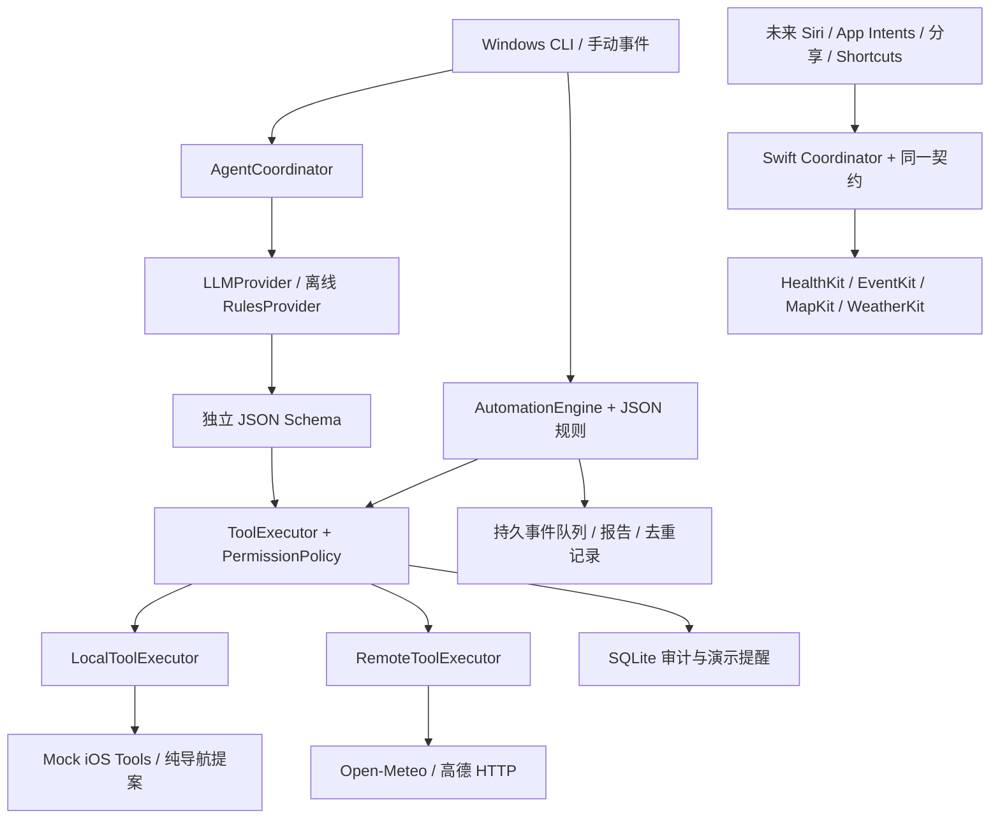

# 技术架构与实施顺序

**Swift-first 当前版：** Standalone v2 附录 A 是最高需求。`SWIFT_FIRST_PLAN.md` 给出本次审查、四包依赖方向和阶段出口。现有 Python 代码仅为参考；Agent/Registry/Policy/Workflow/Provider 主线已写入纯 Swift 包，尚待真实 Swift 编译验证。正式运行时无 Mac、Python、测试 Runner 或 UI 自动化依赖。本文后续保留早期 Python 原型设计记录。

## 项目状态与需求优先级

2026-10-15 初始目录仅有 `PersonalAgent_iOS_Codex_Spec.md`，没有源代码、Git 仓库或 Xcode 工程。本文档区分规格书中的最终产品要求与用户当前明确要求：**先在 Windows 完成可测试的 CLI 原型，迁移 Mac 后再实现原生入口和系统工具**。不创建不必要的服务，不把原规格书的 Mac 前置条件误认为当前机器具备的能力。

## 数据路径

Python 不会成为 Swift 的运行时依赖。两端共享的是 Schema、事件语义和测试向量；不要求复用 Python 代码或数据库文件。

Swift 已开始按小增量落地：`iOS/Packages/DongShaoCore` 提供 Foundation 契约类型、有限 Schema 校验和 actor 注册/确认执行边界，附 XCTest 源码。当前无 Swift 编译器，因此该包未通过构建；完整 Swift Coordinator/LLM/持久化/工作流和 Apple adapter 继续等核心编译验证后逐项迁移。

## 组件职责

| 模块 | 职责与边界 |
|---|---|
| `contracts.py` + `schemas/` | 校验每次调用的 input、成功 output、统一 envelope，拒绝额外字段、无时区日期和非 JSON 数值；运行时无远端 Schema 引用 |
| `ToolRegistry` | 六个已审计工具的有限白名单；新增工具需先增量定义契约与风险，不动态注册可执行脚本 |
| `PermissionPolicy` | 明确 scopes；当前 Mock scope 仅模拟授权，不代表系统权限。真实 adapter 必须再次检查系统授权 |
| `ToolExecutor` | 校验 → 权限 → 时间语义 → 参数预览/可信 UI 确认 → adapter → 输出校验 → 哈希审计 |
| `LocalToolExecutor` | 当前 Mock 或纯 URI 提案；未来是手机内 Swift actor 直接调用 Framework |
| `RemoteToolExecutor` | 固定公共 API adapter；不提供远程任意 URL 调用或绕过手机审批的入口 |
| `LLMProvider` | 每轮返回工具计划或文本；Ollama 是当前实现，其他供应商通过协议替换 |
| `AgentCoordinator` | 多轮串行工具链、预算、重复拦截、模型结果脱敏；只信本地执行状态 |
| `AutomationEngine` | 显式事件映射四个场景；按本地日期/UUID 去重、冷却、安静时段和旧事件归档 |
| `Store` | SQLite 保存事件、报告、演示提醒与脱敏审计；跨 CLI 进程保留状态 |

## 契约约定

所有 Schema 为 Draft 2020-12，版本 `1.0`，`$id` 为 `urn:dongshao:v1:*`，无需服务端获取。六个工具 JSON 文件的 `$defs.input` / `$defs.output` 可独立用于 Swift 类型和验证器。根 `$ref` 默认指向 input；不要拿根校验 output。

`tool-call` 不包含审批字段；可信 CLI/UI 通过独立 callback 传递批准。模型发送 `approved: true` 会因额外字段被拒。导航参数仅有 `place_id` 与出行方式；坐标和 URI 全由本地 adapter 从本轮搜索缓存构造。多候选的 `--place-id` 由用户提供。真实 adapter 在使用时重新核对坐标系统和目标，不能把重试之前的选择作为永久授权。

成功数据按各工具 output 校验；统一 `tool-result` 包含 trace、来源、Mock 标记、收集时间、错误代码及是否可重试。待确认提醒用 `data.preview` 展示已校验 input；待确认导航返回完整 `data.action`。非成功状态可无业务 output，因此先读 status，再解码业务数据。`collected_at` 是取数时间，不保证源数据已经同步到最新，健康记录另含结束时间；未来 Swift adapter 应扩展来源新鲜度字段时走版本管理。

模型使用 `weather__forecast` 等别名满足常见函数名限制，适配器明确映射回 `weather.forecast`。模型返回的未知名称、非法参数和异常结构在本轮执行前拒绝。`fixtures/tool-cases.json` 是 Python/Swift 共用测试向量，统一状态机与 Mock 语义；原生健康值不要求等于演示数据。

`simulated`、`opened` 与 `delivered` 在契约中为布尔值，允许未来 Swift 表达真实执行；当前 Python 实现分别严格标注演示写入/从未打开/从未投递。没有为了通过 Windows 测试而把真实结果写死为 Mock 的契约。

## 工作流与持久性

| 场景 | 数据 | 去重 | 输出 |
|---|---|---|---|
| 晨间简报 | 指定事件日天气、睡眠/活动、日程 | `morning_brief:本地日期` | 当日概览、缺失说明、本地规则建议 |
| 离家提醒 | 天气、日程 | 事件 ID；日期+风险类别指纹 | 只建议新风险，冷却/安静时段控制 |
| 运动分析 | `health.summary.workouts` 中与 UUID 匹配的聚合 | workout ID | 时长/距离/配速；缺失距离不伪造；未同步则待重试 |
| 每日复盘 | 当日日程、健康、本地演示提醒记录数 | `daily_review:本地日期` | 归档报告；低信息量不建议通知 |

处理事件使用 SQLite `BEGIN IMMEDIATE`，同一事务中更新尝试次数、报告和通知**策略决定**，重复 CLI 不产生重复报告。网络可重试错误保留 pending，不把失败当作已完成。`replay` 显式重试，默认每事件共三次、每次最多二十条。同步仍失败的事件保留，不无限自旋；改好配置后可提高规则中的上限再重试。当前事务可能覆盖一次只读 HTTP 请求，适合单用户串行 CLI；原生阶段应使用持久 claim/lease 缩短持锁时间。

当前不运行定时器/监听守护进程，没有 iOS 后台常驻承诺。通知记录仅记录建议，不代表已经投递；未来原生必须把“已决定、提交系统、失败”分开持久化。iPhone 健康 anchor/删除对象处理属于后续原生阶段，本次未伪造同步器。

## 本阶段模块顺序与出口

1. 能力核验与契约：Schema/日期/权限测试通过。
2. Registry / Executor / 六个 Mock：成功、拒绝、取消、未知工具、歧义、时区和幂等测试通过。
3. 公共 API：HTTP 超时、限流重试、大小限制与错误脱敏；协议夹具测试；天气单次真实请求通过。
4. Planner / Coordinator：离线验收、多轮模型协议、隐私脱敏、预算测试通过。真实模型等待用户配置。
5. 自动化 / CLI：四个事件、持久去重、离线 replay、静默规则和 CLI 子进程测试通过。
6. Mac 迁移：先编译契约与执行器，再每次只替换一个 Mock；完成 Xcode build/test 和 iPhone 检查才能进入下个原生模块。
